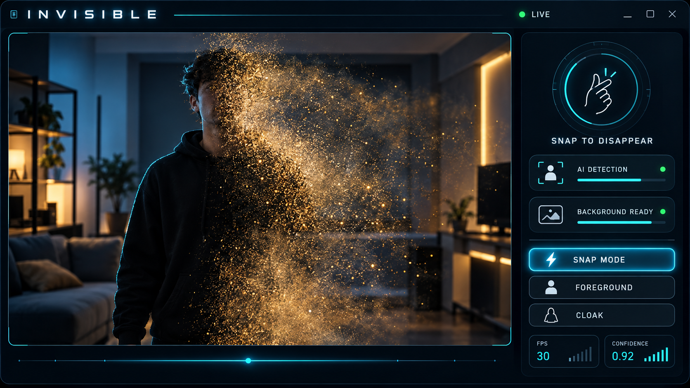

# Invisible Man

A real-time cinematic invisibility effect built with Python, OpenCV, Ultralytics YOLO segmentation, and MediaPipe hand tracking.

The application captures an empty background, separates people and newly introduced objects from the scene, detects a finger snap, and turns the foreground into a procedural dust-dissolve animation before making it invisible.



## Features

- Automatic median-based background capture
- YOLO person instance segmentation
- Background-difference detection for objects YOLO does not recognise
- MediaPipe 21-point hand tracking and finger-snap sequence detection
- Cinematic procedural dust-particle dissolve
- Motion-adaptive mask smoothing with reduced movement trails
- Automatic coloured-cloak detection with HSV hue-wrap support
- Custom 1600×900 cinematic OpenCV interface
- Clickable mode, recapture, and mask controls
- Live FPS, confidence, AI, and background status indicators
- Local processing with no camera recording or frame uploads

## Modes

| Mode | Behaviour |
| --- | --- |
| **Snap** | Shows the live foreground until a finger snap triggers the dust dissolve and invisibility effect. This is the default mode. |
| **Foreground** | Immediately hides people and every object that was absent from the captured background. |
| **Cloak** | Detects a bright single-colour cloth and replaces only that region with the background. |

## Requirements

- Python 3.10 or newer
- Webcam
- Even lighting
- Stationary camera
- Internet access on the first run to download the YOLO and MediaPipe model files
- Optional bright red, green, or blue cloth for Cloak mode

## Installation

### Windows PowerShell

```powershell
git clone https://github.com/sankalpalokuliyanage/Invisible-Man.git
cd Invisible-Man
python -m venv .venv
.\.venv\Scripts\Activate.ps1
python -m pip install --upgrade pip
python -m pip install -r requirements.txt
```

Start the application:

```powershell
python invisible_man.py
```

The small `yolo26n-seg.pt` model and MediaPipe hand-landmark model download automatically the first time they are needed.

## Using Snap mode

1. Start the application and immediately step completely out of the camera view.
2. Wait for the automatic three-second background capture to finish.
3. Return to the camera and hold one hand clearly in view.
4. Touch the thumb and middle fingertip together.
5. Release the middle finger quickly to perform a visible snapping motion.
6. The detected foreground dissolves into particles and becomes invisible.

For reliable detection, face the palm towards the camera, keep the hand well lit, and avoid covering the fingertips. Press `S` to test the animation without performing the gesture.

## Controls

| Control | Action |
| --- | --- |
| Snap Mode button | Arm automatic snap detection |
| Foreground button / `F` | Hide the complete new foreground immediately |
| Cloak button / `C` | Enable automatic coloured-cloth invisibility |
| Recapture button / `R` / `B` | Capture a new empty background |
| Mask button / `M` | Show or hide the detection mask |
| `S` | Manually trigger the snap dissolve for testing |
| `A` | Reset automatic cloak-colour detection |
| Camera click in Cloak mode | Manually select a cloth colour |
| `Q` / `Esc` | Exit |

## Command-line options

```text
--camera INDEX                 Select a webcam device (default: 0)
--width PIXELS                Request a camera width (default: 1280)
--height PIXELS               Request a camera height (default: 720)
--no-mirror                   Disable the mirrored selfie view
--background-seconds SECONDS  Set background capture duration (default: 3)
--effect MODE                 Start in snap, foreground, or cloak mode
--model MODEL                 Select an Ultralytics segmentation model
--no-yolo                     Use lightweight OpenCV detection without YOLO
```

Examples:

```powershell
# Use a second webcam
python invisible_man.py --camera 1

# Spend longer producing a cleaner background model
python invisible_man.py --background-seconds 5

# Start with immediate foreground invisibility
python invisible_man.py --effect foreground

# Run on a slower computer without neural segmentation
python invisible_man.py --no-yolo
```

## How it works

1. Up to 30 empty-scene frames are combined with a median operation to build a clean background.
2. OpenCV compares each live frame with that background to find every newly introduced foreground region.
3. YOLO segmentation supplies a detailed person silhouette and fills areas that resemble the background.
4. The masks are combined, filtered by connected-component size, and stabilised with fast motion-adaptive attack/release blending.
5. MediaPipe tracks hand landmarks and looks for thumb–middle-finger contact followed by a sufficiently fast release.
6. A deterministic noise field progressively erodes the subject mask while sampled foreground pixels become animated dust particles.
7. Dissolved pixels are replaced with the previously captured background.

## Tips for best results

- Mount or place the webcam on a stable surface.
- Leave the complete camera view during background capture.
- Use soft, even lighting and avoid rapidly changing sunlight.
- Keep the background still after it has been captured.
- Use the Mask view to diagnose unwanted foreground regions.
- Recapture the background whenever the camera or furniture moves.
- If performance is low, reduce the requested resolution or use `--no-yolo`.
- In Cloak mode, use a vivid cloth colour that is absent from your clothes and background.

## Troubleshooting

### The wrong camera opens

Try another device index:

```powershell
python invisible_man.py --camera 1
```

### Movement leaves visible trails

Use brighter lighting to reduce camera blur, keep the webcam stationary, and recapture the background. Lowering the camera resolution can also improve inference speed.

### The snap is not detected

Bring the hand closer to the camera, face the palm forward, and clearly show the thumb and middle fingertip making contact before a quick release. Use `S` to confirm that the dissolve animation itself works.

### Background objects disappear

Press `R` and leave the entire view during capture. Moving curtains, screens, shadows, or reflections can be classified as new foreground.

### Model download fails

Check the internet connection and run the application again. Downloaded model files are cached locally and excluded from Git.

## Project structure

```text
Invisible-Man/
├── invisible_man.py       # Camera loop and hybrid vision pipeline
├── cinematic_ui.py        # Custom OpenCV interface renderer
├── snap_effect.py         # Hand-snap detector and dust animation
├── requirements.txt       # Python dependencies
└── assets/ui/             # UI concept artwork
```

## Privacy

Camera frames are processed locally. The application does not record video, save camera frames, perform identity recognition, or upload captured footage.

## License

No licence file is currently included. Add a licence before redistributing or publishing modified versions of the project.
